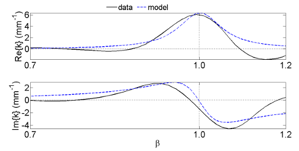
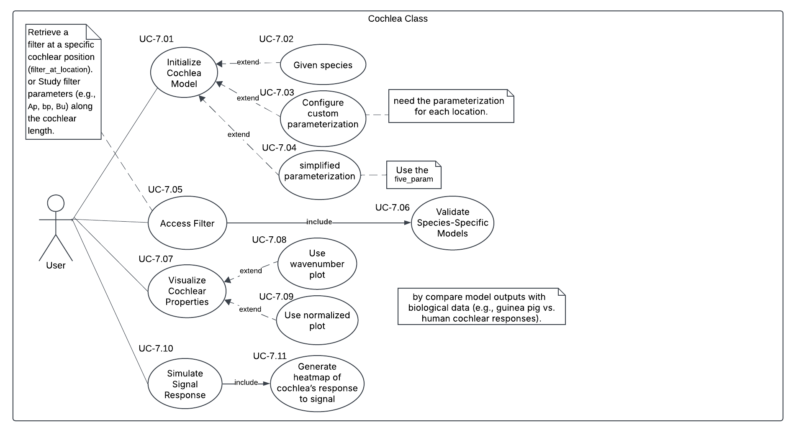
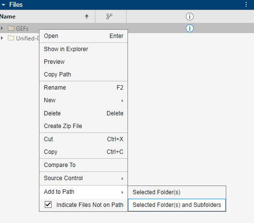

# Unified-Cochlear-Model
A unified cochlear model of the mammalian cochlea that ties together the transfer function perspective and the traveling wave perspective, and hence may be used to study the mechanisms of the (single partition) cochlear model and also doubles as cochlear filters.

## Capabilities for Studying Auditory Physics and Cochlear Mechanics

* Variables of the cochlear model include (1) response variables (which are related to the filters in GEFs toolbox) that may in principle be observed in some species: differential pressure across the OoC, and OoC velocity, as well (2) mechanistic variables which contain information how the model works: the differential pressure wavenumber, and the effective impedance of the OoC.
* A user may specify a species (human or chinchilla) or model constants that vary slowly along the length of the cochlea to generate the mechanistic variables and functional response variables.
* A user may study the dependence of mechanistic variable behavior on observed response characteristics.
* Alternatively, given reported response characteristics such as quality factors and group delays, the methods can be used to estimate the underlying mechanistic variables which encode properties of interest to auditory physicists such as negative effective damping. This feature  is enabled by the GEFs toolbox filter designing methods where desired values for characteristics are provided to design filters which map onto response variables in the cochlear model.
* A user may be interested in the model variables from a traveling wave perspective (as a function of $x$ for a constant $\omega$) or from a transfer function perspective (as a function of $\omega$ for a constant $x$). The two perspectives are tied together via an assumption of local scaling symmetry of the wavenumber.
* __Key Assumptions:__ 
  * The cochlear model is related to the filterbank (part of the GEFs toolbox) and assumes an uncoiled box model of the cochlea with a single partition for the Organ of Corti (OoC). 
  * The model is developed based on observations from the response of the active mammalian cochlea to low stimulus levels (and hence linear). 
  * The derivation also assumes local scaling symmetry of the wavenumber - i.e. the model constants or filter characteristics such as quality factors vary slowly along the length of the cochlea. 
  * The scaling factor due to the long-wave region (which is not modeled) is assumed to be frequency independent relative to the model 
  * The magnitudes are adjusted to all have the same peak magnitude.

### Mathematical Formulation

Parameterized filters representing the cochlea are constructed based on the model in [1]. The transfer functions (in terms of $s$) are defined as:

* **Pressure Modeling:** $$H_p(s) = C \frac{1}{\left((s-p)(s-\overline{p})\right)^{B_u}}$$
* **Velocity Modeling:** $$H_v(s) = C \frac{(s+A_p)}{\left((s-p)(s-\overline{p})\right)^{B_u+1}}$$

Where the pole is defined as $p = ib_p - A_p$.<br>
**Parameter Input:** The variables $A_p$, $b_p$, and $B_u$ can be directly inputted into the model, while $C$ can be inputted in two different ways.


## Relationship to GEFs Toolbox

This model is built as a specialized application of the GEFs Toolbox **[[Link]](https://github.com/AnalyticModeling/GEFs)**:

* **Architecture:** Cochleas are treated as instances of `Filterbanks` (in GEFs toolbox) with additional cochlear characteristics attached.
* **Operational Framework:** The internal logic of the model tends toward the GEFs architectural framework, using its design methods to translate biological characteristics into functional filters that represent cochlear response variables.

### General Filters and Signals: Filterbanks and Cochleas
* Filterbanks are treated as graphs on filters. The most common filterbanks will have filters in series or parallel.
* Cochleas are examples of filterbanks with extra functionality attached. They may also be specified by providing only a species, in which case default values are used.

<p align="center">
  
  <br>
  <em>Figure 3 from paper [1].</em>
</p>

## Model Initialization Methods

* **Given Species:** Users can instantly initialize a model by specifying a species (e.g., `'human'`, `'chinchilla'`). 
* **Simplified Parameterization:** Beyond discrete filters, the model supports a **five-parameter parameterization**. This allows for defining how mechanistic variables like $A_p$ and $B_u$ vary slowly along the length of the cochlea as functions of the characteristic frequency, streamlining the transition from local filter behavior to a continuous cochlear model.
* **Configure custom parameterization:** The model automatically handles the mapping between physical locations along the cochlea ($x$ in mm) and their corresponding characteristic frequencies ($cf$ in kHz) using exponential mapping functions. This ensures that custom-input constants or characteristic frequencies are correctly translated into spatial coordinates along the cochlear partition.

## Tutorials and Documentation

* **MATLAB:** 
  * Run `alkhairy2019.m` to generate some figures from paper [1] .
  * Run `alkhairy2022.m` to generate some figures from paper [2].
  * Run `demo_model.m` to interactively explore the model's capabilities.
* **Python:** 
  * Run `plot_tutorial.py` to generate the foundational figures from paper [1] and [2]. 
  * Run `demo_model.py` to interactively explore the model's capabilities.

### Use Case Diagram 

<p align="center">
  
  <br>
  <em>Use case diagram for cochlea capabilities.</em>
</p>

## Requirements for Running the Model

### 1. Python Environment
The toolbox may be used in Python or MATLAB. In either case, you will need to install **Python 3.12** **[[Link]](https://www.python.org/downloads/release/python-3128/)**.

### 2. Installing Refactoring Branch of GEFs Toolbox (Mandatory)
Before running this model, the **GEFs Toolbox** ( Refactoring branch ) must be installed on your device. The `Cochlea` class is built as a specialized application of the GEFs engine and cannot function without it. can be installed directly by running the following on the device terminal :

#### 2.1. Installation via Python Via Terminal (PowerShell/PyCharm)
For users working in Python, it is highly recommended to run these commands via Terminal (PowerShell/PyCharm):

```
pip install setuptools wheel
pip install --no-build-isolation git+https://github.com/AnalyticModeling/GEFs.git@Refactoring
```

#### 2.2. Installation via MATLAB (command Window)
To use the model's features within MATLAB, The GEFs toolbox Refactoring branch must be cloned :

```
!git clone -b Refactoring https://github.com/AnalyticModeling/GEFs.git
```
Once the folder appears in your "Current Folder" browser in MATLAB, do the following ( Whether you are performing a first-time installation or not, it is a must step ) :

* Right-click the GEFs folder.
* Select Add to Path > Selected Folders and Subfolders.

<p align="center">
  
  <br>
  <em>Important step</em>
</p>

### 3. Libraries Installation
To install the necessary dependencies, navigate to the project folder and run the following command in your terminal:

```
$ pip install -r requirements.txt
```
## Cochlea Model Installation

Once the GEFs Toolbox and requirements are met, follow these steps to set up the **Unified-Cochlear-Model** repository on your local machine.

### Clone the Repository (For Python)
Open your terminal and clone the project repository using the commands below (Via Terminal (PowerShell/PyCharm)):

```
git clone https://github.com/AnalyticModeling/Unified-Cochlear-Model.git
```

### Clone the Repository (For MATLAB)
Run the follwing in the command window:
```
!git clone https://github.com/AnalyticModeling/Unified-Cochlear-Model.git
```

## Contributing

please complete the following validation steps before submitting a pull request:

### Python Validation
The Python implementation includes a unit testing suite located in the `tests/` directory.
* **Run Unit Test:** Execute all files within the `tests/` folder. Ensure the output for each test is "Passed" or as expected. 
    * *Note: There is currently one known minor test failure; please ensure your changes do not introduce any additional regressions.*
* **Run Demo:** Execute `demo_model.py` to verify that the core model visualizations and functionalities remain intact.

### MATLAB Validation
please manually verify the MATLAB implementation to ensure changes do not break the logic:
* Run `alkhairy2019.m` and `alkhairy2022.m` to check for execution errors.
* **Run Demo:** Execute `demo_model.m` and confirm the output matches the expected physiological behavior.

## References

[1] Alkhairy, S. A., & Shera, C. A. (2019). An analytic physically motivated model of the mammalian cochlea. The Journal of the Acoustical Society of America, 145(1), 45-60. [link](https://doi.org/10.1121/1.5084042).  
[2] Alkhairy, S. A. (2024, February). Cochlear wave propagation and dynamics in the human base and apex: Model-based estimates from noninvasive measurements. In AIP Conference Proceedings (Vol. 3062, No. 1). AIP Publishing. [link](https://doi.org/10.1063/5.0189264).   
